# 体质测试数据分析及可视化设计

> 🎓 **计算机毕业设计 · 体质测试数据分析及可视化设计**
>
> 本仓库只放**项目介绍 + 运行截图**（截图是站点带水印的原图，存在仓库 `images/` 里）。
>
> 👉 **完整可运行源码 / 数据库脚本 / 部署文档：[点我获取](https://geekcode.top/archives/%E4%BD%93%E8%B4%A8%E6%B5%8B%E8%AF%95%E6%95%B0%E6%8D%AE%E5%88%86%E6%9E%90%E5%8F%8A%E5%8F%AF%E8%A7%86%E5%8C%96%E8%AE%BE%E8%AE%A1?utm_source=github)**
>
> 💬 咨询微信：**ir9372**　|　🌐 更多项目：[极客代码 geekcode.top](https://geekcode.top/?utm_source=github)
>
> 📌 项目详情页：<https://geekcode.top/archives/%E4%BD%93%E8%B4%A8%E6%B5%8B%E8%AF%95%E6%95%B0%E6%8D%AE%E5%88%86%E6%9E%90%E5%8F%8A%E5%8F%AF%E8%A7%86%E5%8C%96%E8%AE%BE%E8%AE%A1?utm_source=github>

<table><td width="230" align="center"> <b>扫码加微信 ir9372</b></td><td valign="middle">📦 源码 = 项目介绍 + 全部运行截图 + 数据库 + 部署文档 👉 点上方任意截图，直接跳到 <b>极客代码 geekcode.top</b> 详情页</td></table>

---

<h1>体质测试数据分析及可视化设计</h1>
<h2>项目概述</h2>

本项目名为“体质测试数据分析及可视化设计”，旨在构建一个集数据采集、存储、分析与展示于一体的综合性管理平台。系统核心功能涵盖学生与教师信息管理、日常运动记录、成绩信息录入、运动数据分析以及师生互动沟通等模块。通过前后端分离架构，系统不仅支持后台管理员对基础数据（如公告、论坛、轮播图）的统一维护，还为前台用户提供个性化的个人中心、论坛交流及数据查询服务。该项目适用于学校体育部门或健康管理机构，用于提升体质测试数据的处理效率，实现运动表现的可视化监控，并促进师生间关于健康运动的即时沟通。技术架构上采用 Spring Boot 作为后端框架，结合 MyBatis-Plus 进行持久层开发，使用 Shiro 保障系统安全，前端基于 Vue 生态构建交互界面，实现了业务逻辑与用户界面的解耦。

<h2>技术架构</h2>

本系统采用典型的前后端分离架构模式，确保系统的可维护性与扩展性。

<strong>1. 后端架构</strong>
后端基于 Java 语言，使用 <strong>Spring Boot</strong> 作为核心应用框架，利用其自动配置特性简化开发流程。持久层采用 <strong>MyBatis-Plus</strong>，它在原生 MyBatis 基础上提供了通用的 CRUD 操作和条件构造器，显著减少了 SQL 编写工作量，同时保持了对复杂查询的支持能力。数据库连接使用 <strong>MySQL</strong>，通过 <code>mysql-connector-java</code> 驱动实现数据交互。安全认证与授权模块集成 <strong>Apache Shiro</strong>，负责处理用户登录状态、权限校验及会话管理，确保不同角色访问资源的合法性。此外，引入 <code>commons-lang3</code> 和 <code>validation-api</code> 分别用于工具类封装和数据参数校验，保证接口调用的健壮性。

<strong>2. 前端架构</strong>
前端采用 <strong>Vue.js</strong> 框架构建单页面应用（SPA），配合 Element UI 或其他组件库实现丰富的用户界面交互。项目类型为 <code>vue-integrated</code>，意味着前端代码与后端部署可能存在整合或紧密协作关系。前端通过 Axios 等 HTTP 客户端与后端 RESTful API 进行通信，动态渲染论坛、公告、成绩及运动分析等数据列表与详情页。

<strong>3. 核心技术选型理由</strong>

<ul>
<li><strong>Spring Boot + MyBatis-Plus</strong>：成熟稳定，社区活跃，能够快速搭建企业级应用，适合处理结构化业务数据。</li>
<li><strong>Shiro</strong>：相比 Spring Security，Shiro 更轻量且易于理解，适合中小型项目的权限控制需求。</li>
<li><strong>Vue.js</strong>：响应式数据绑定机制使得界面更新更加高效，组件化开发利于复用前台的个人中心、列表页等通用模块。</li>
</ul>
<h2>功能模块</h2>

根据源码中的 Controller 列表及截图功能展示，系统主要划分为前台用户端和后台管理端两大功能板块。

<h3>前台用户端</h3>

前台界面主要面向注册用户（包括学生、教师等），提供信息查询、互动及个人数据管理服务。

<ol>
<li><strong>首页与信息浏览</strong></li>
</ol>
<ul>
<li><strong>公告信息</strong>：展示系统发布的最新通知，支持列表查看及详情阅读。</li>
<li><strong>论坛信息</strong>：提供公共讨论区，用户可查看帖子列表、进入详情页参与互动。</li>
<li><strong>轮播图展示</strong>：在首页顶部展示动态图片，用于宣传或导航指引。</li>
</ul>
<ol start="2">
<li><strong>个人数据中心</strong></li>
</ol>
<ul>
<li><strong>个人中心</strong>：显示用户基本信息，提供资料修改入口。</li>
<li><strong>我的发布</strong>：用户可查看自己发布的论坛帖子或相关记录。</li>
</ul>
<ol start="3">
<li><strong>专项业务模块</strong></li>
</ol>
<ul>
<li><strong>成绩信息</strong>：展示学生的体质测试成绩，支持列表查询与详情查看，便于回顾历史数据。</li>
<li><strong>日常运动</strong>：记录用户的每日运动情况，提供列表与详情页，帮助用户追踪运动习惯。</li>
<li><strong>运动分析</strong>：基于采集的数据生成分析报告，以可视化形式呈现运动趋势与健康指标，支持列表与详情查看。</li>
<li><strong>教师列表/详情</strong>：展示教师基本信息，方便学生了解师资情况。</li>
</ul>
<ol start="4">
<li><strong>互动交流</strong></li>
</ol>
<ul>
<li><strong>师生沟通聊天</strong>：提供即时通讯功能，允许学生与教师在线交流，解决疑问或反馈问题。</li>
</ul>
<ol start="5">
<li><strong>账户管理</strong></li>
</ol>
<ul>
<li><strong>登录/注册</strong>：新用户需注册账号，老用户通过登录验证身份后进入系统。</li>
</ul>
<h3>后台管理端</h3>

后台界面主要面向管理员，用于系统全局配置、内容审核及基础数据维护。

<ol>
<li><strong>内容管理系统 (CMS)</strong></li>
</ol>
<ul>
<li><strong>论坛管理</strong>：管理员可对前台发布的论坛帖子进行审核、删除或置顶操作 (<code>/forum</code>)。</li>
<li><strong>公告信息管理</strong>：发布、编辑或删除系统公告 (<code>/news</code>)。</li>
<li><strong>轮播图管理</strong>：配置首页展示的轮播图片资源 (<code>/config</code> 相关部分)。</li>
</ul>
<ol start="2">
<li><strong>基础数据管理</strong></li>
</ol>
<ul>
<li><strong>学生管理</strong>：维护学生档案信息，包括增删改查 (<code>/xuesheng</code>)。</li>
<li><strong>教师管理</strong>：维护教师档案信息，包括增删改查 (<code>/jiaoshi</code>)。</li>
</ul>
<ol start="3">
<li><strong>业务数据管理</strong></li>
</ol>
<ul>
<li><strong>成绩信息管理</strong>：录入、修改或删除学生的体质测试成绩数据 (<code>/chengjixinxi</code>)。</li>
<li><strong>日常运动管理</strong>：查看和管理用户的日常运动记录 (<code>/richangyundong</code>)。</li>
<li><strong>运动分析管理</strong>：监控和分析运动数据报表 (<code>/yundongfenxi</code>)。</li>
<li><strong>师生沟通管理</strong>：查看聊天记录或管理沟通模块的相关设置 (<code>/chat</code>)。</li>
</ul>
<ol start="4">
<li><strong>系统配置</strong></li>
</ol>
<ul>
<li><strong>系统参数配置</strong>：管理网站的基础配置项 (<code>/config</code>)。</li>
</ul>
<h2>用户角色与权限</h2>

系统基于 Apache Shiro 实现权限控制，主要涉及以下三类角色，各角色拥有不同的功能访问权限：

<table>
<thead>
<tr>
<th align="left">角色名称</th>
<th align="left">描述</th>
<th align="left">可访问的功能模块</th>
</tr>
</thead>
<tbody><tr>
<td align="left"><strong>管理员</strong></td>
<td align="left">系统最高权限持有者，负责整体运营与维护。</td>
<td align="left"><strong>全部后台功能</strong>：1. 论坛管理2. 公告信息管理3. 学生信息管理4. 教师信息管理5. 成绩信息管理6. 日常运动管理7. 运动分析管理8. 师生沟通管理9. 轮播图/系统配置管理<strong>前台功能</strong>：通常不直接使用前端的业务查询界面，或通过特殊入口访问。</td>
</tr>
<tr>
<td align="left"><strong>教师</strong></td>
<td align="left">教育指导人员，侧重于数据查看与沟通。</td>
<td align="left"><strong>前台功能</strong>：1. 个人中心（查看/修改资料）2. 我的发布（查看自己发的帖子）3. 论坛信息（浏览、发帖）4. 公告信息（浏览）5. 成绩信息（可能仅限查看关联学生或特定范围，具体视业务逻辑而定，截图中有列表入口）6. 日常运动（查看相关数据）7. 运动分析（查看分析结果）8. 师生沟通聊天（与学生互动）9. 教师列表/详情（查看同行信息）<strong>注意</strong>：根据常规毕设逻辑，教师通常不具备后台管理权限，除非被赋予特殊角色。此处仅依据前台路由推断其可见范围。</td>
</tr>
<tr>
<td align="left"><strong>学生</strong></td>
<td align="left">普通用户，侧重于自身数据记录与查询。</td>
<td align="left"><strong>前台功能</strong>：1. 个人中心（查看/修改资料）2. 我的发布（查看自己发的帖子）3. 论坛信息（浏览、发帖）4. 公告信息（浏览）5. 成绩信息（查看自己的体质测试成绩）6. 日常运动（记录/查看自己的运动数据）7. 运动分析（查看自己的运动分析报告）8. 师生沟通聊天（向老师提问）9. 教师列表/详情（查看老师联系方式等信息）</td>
</tr>
</tbody></table>

<em>注：具体权限粒度（如是否允许教师修改成绩）未在提供的上下文中明确定义，以上表格基于标准校园管理系统角色职责及现有菜单结构推导。</em>

<h2>项目特色与创新点</h2>
<ol>
<li>
<strong>数据驱动的可视化分析</strong>
   项目不仅仅是简单的信息录入系统，而是引入了“运动分析”模块。通过对“日常运动”和“成绩信息”数据的积累，系统能够提供可视化的分析视图，帮助用户直观了解体质变化趋势，体现了从“数据记录”到“数据价值挖掘”的转变。

</li>
<li>
<strong>多维度的互动沟通机制</strong>
   除了传统的“论坛”异步交流外，系统专门设计了“师生沟通聊天”模块。这种即时通讯能力的加入，打破了传统教务系统中师生沟通滞后的痛点，增强了平台的社交属性和实时服务能力。

</li>
<li>
<strong>完整的闭环业务流程</strong>
   系统涵盖了从“学生/教师基础档案建立” -&gt; “日常运动/成绩数据采集” -&gt; “运动分析生成” -&gt; “论坛/聊天互动反馈”的完整闭环。这种设计符合现代智慧校园或健康管理平台的标准流程，具有较强的实用性和完整性。

</li>
<li>
<strong>灵活的前后端分离架构</strong>
   采用 Vue 与 Spring Boot 分离开发，使得前端界面可以独立于后端逻辑进行迭代优化，同时也便于未来扩展移动端适配或多终端接入，提升了系统的可维护性和用户体验。

</li>
</ol>
<h2>部署环境</h2>

为确保“体质测试数据分析及可视化设计”系统的正常运行，需要准备以下软硬件环境：

<strong>1. 硬件环境</strong>

<ul>
<li><strong>服务器</strong>：建议 CPU 4核及以上，内存 8GB 及以上，硬盘空间 50GB 可用。</li>
<li><strong>开发机</strong>：普通 PC 即可，建议内存 8GB 以上以流畅运行 IDE 和浏览器调试。</li>
</ul>

<strong>2. 软件环境</strong>

<ul>
<li><strong>操作系统</strong>：Windows 10/11, Linux (CentOS 7+, Ubuntu 18.04+) 或 macOS。</li>
<li><strong>JDK 版本</strong>：Java Development Kit 1.8 或更高版本（推荐 JDK 1.8，兼容性好）。</li>
<li><strong>数据库</strong>：MySQL 5.7 或 MySQL 8.0。需初始化对应的表结构和数据。</li>
<li><strong>Web 容器</strong>：内置 Tomcat（由 Spring Boot Starter Web 提供），无需单独安装外部 Tomcat。</li>
<li><strong>Node.js</strong>：用于前端依赖管理和构建，建议版本 v14.x 或 v16.x LTS。</li>
<li><strong>包管理器</strong>：npm 或 yarn（用于安装前端 Vue 项目依赖）。</li>
<li><strong>Maven</strong>：用于后端 Java 项目的依赖管理和构建，建议版本 3.6+。</li>
</ul>

<strong>3. 其他工具</strong>

<ul>
<li><strong>IDE</strong>：IntelliJ IDEA (后端), VS Code (前端)。</li>
<li><strong>API 测试工具</strong>：Postman 或 Swagger UI（如果集成）。</li>
<li><strong>浏览器</strong>：Chrome, Edge, Firefox 等主流现代浏览器。</li>
</ul>
<h2>五、技术特性</h2>
<ul>
<li>前后端集成部署，前端资源打包至后端 static 目录</li>
<li>使用 MyBatis-Plus 简化数据访问层开发</li>
<li>集成 Shiro 权限框架实现角色权限控制</li>
</ul>
<h2>六、功能模块截图</h2>
<h3>前台用户端</h3>
<h4>前台首页</h4>

<a href="https://geekcode.top/archives/%E4%BD%93%E8%B4%A8%E6%B5%8B%E8%AF%95%E6%95%B0%E6%8D%AE%E5%88%86%E6%9E%90%E5%8F%8A%E5%8F%AF%E8%A7%86%E5%8C%96%E8%AE%BE%E8%AE%A1?utm_source=github" title="查看完整源码">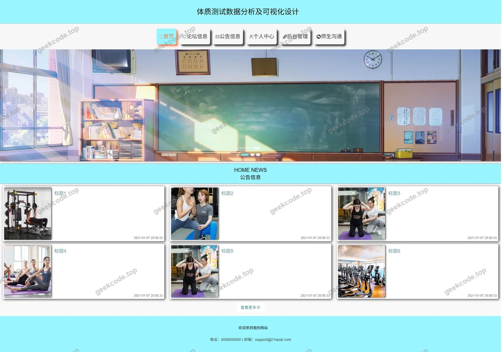</a>

<h4>前台登录页</h4>

<h4>前台注册页</h4>

<a href="https://geekcode.top/archives/%E4%BD%93%E8%B4%A8%E6%B5%8B%E8%AF%95%E6%95%B0%E6%8D%AE%E5%88%86%E6%9E%90%E5%8F%8A%E5%8F%AF%E8%A7%86%E5%8C%96%E8%AE%BE%E8%AE%A1?utm_source=github" title="查看完整源码">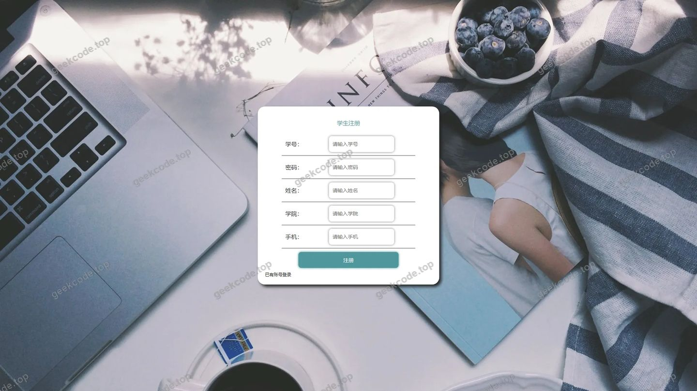</a>

<h4>前台-论坛信息列表</h4>

<a href="https://geekcode.top/archives/%E4%BD%93%E8%B4%A8%E6%B5%8B%E8%AF%95%E6%95%B0%E6%8D%AE%E5%88%86%E6%9E%90%E5%8F%8A%E5%8F%AF%E8%A7%86%E5%8C%96%E8%AE%BE%E8%AE%A1?utm_source=github" title="查看完整源码">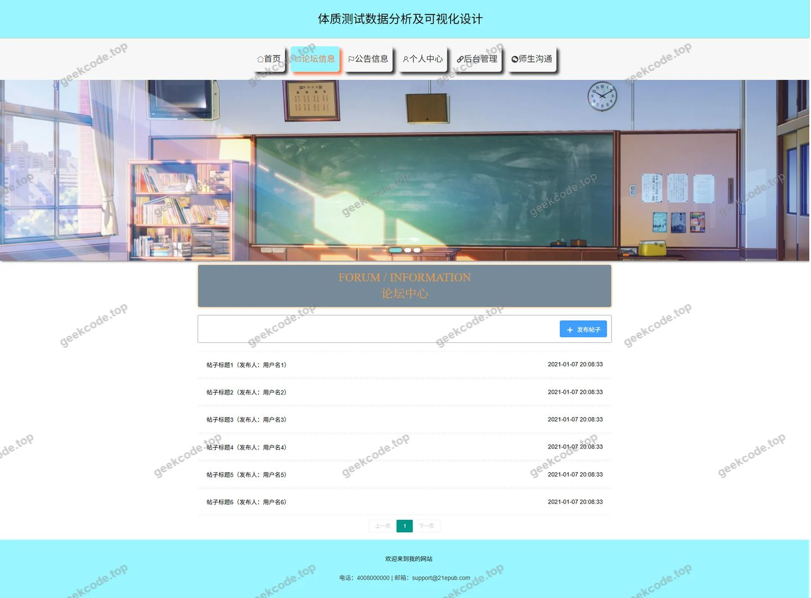</a>

<h4>前台-公告信息列表</h4>

<a href="https://geekcode.top/archives/%E4%BD%93%E8%B4%A8%E6%B5%8B%E8%AF%95%E6%95%B0%E6%8D%AE%E5%88%86%E6%9E%90%E5%8F%8A%E5%8F%AF%E8%A7%86%E5%8C%96%E8%AE%BE%E8%AE%A1?utm_source=github" title="查看完整源码">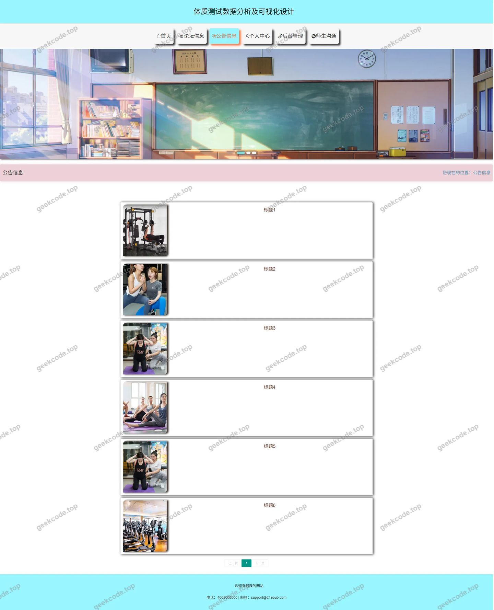</a>

<h4>前台个人中心</h4>

<a href="https://geekcode.top/archives/%E4%BD%93%E8%B4%A8%E6%B5%8B%E8%AF%95%E6%95%B0%E6%8D%AE%E5%88%86%E6%9E%90%E5%8F%8A%E5%8F%AF%E8%A7%86%E5%8C%96%E8%AE%BE%E8%AE%A1?utm_source=github" title="查看完整源码">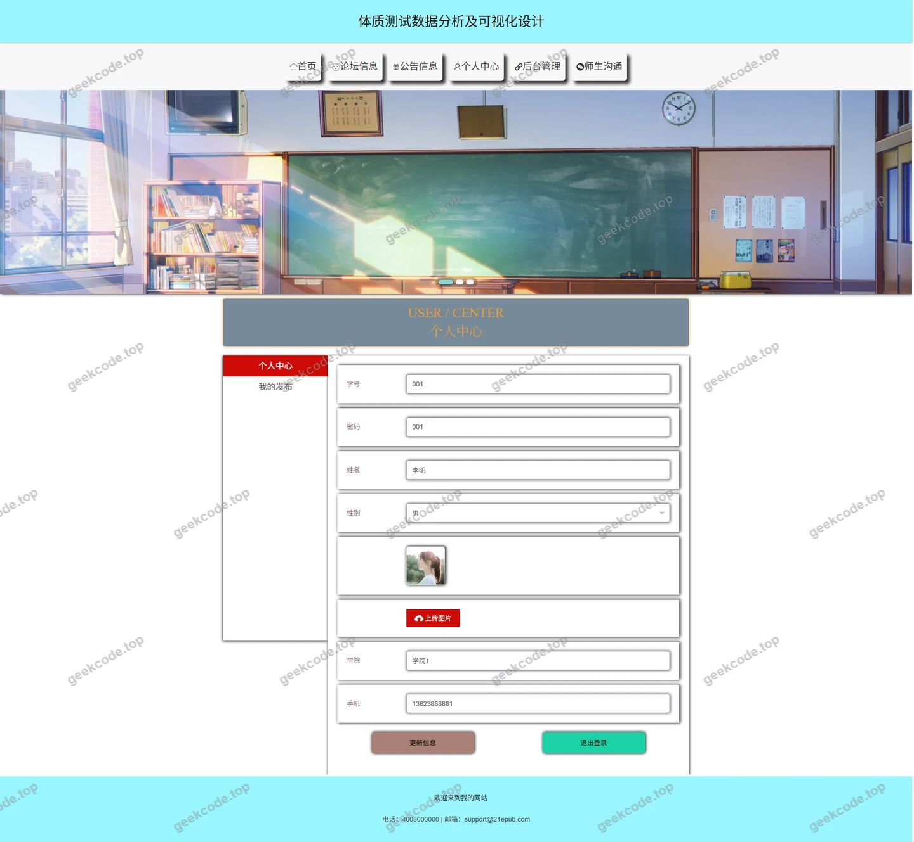</a>

<h4>前台-论坛信息-详情</h4>

<a href="https://geekcode.top/archives/%E4%BD%93%E8%B4%A8%E6%B5%8B%E8%AF%95%E6%95%B0%E6%8D%AE%E5%88%86%E6%9E%90%E5%8F%8A%E5%8F%AF%E8%A7%86%E5%8C%96%E8%AE%BE%E8%AE%A1?utm_source=github" title="查看完整源码">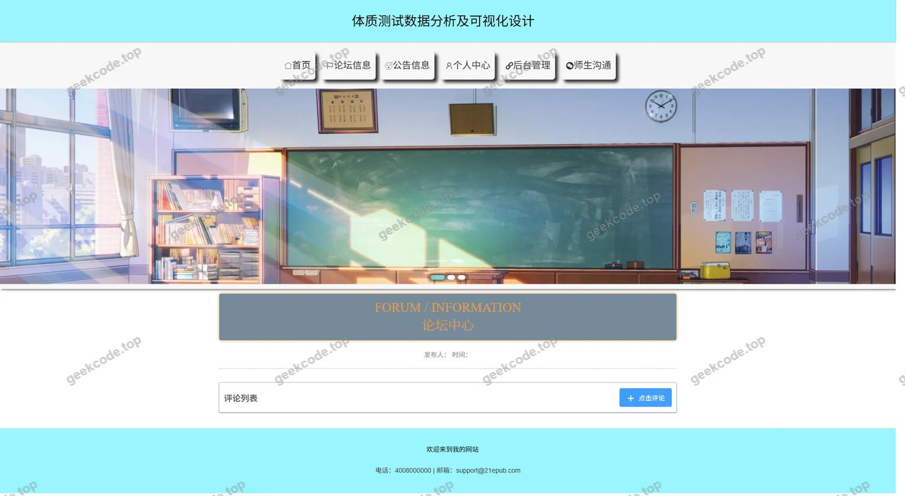</a>

<h4>前台-公告信息-详情</h4>

<a href="https://geekcode.top/archives/%E4%BD%93%E8%B4%A8%E6%B5%8B%E8%AF%95%E6%95%B0%E6%8D%AE%E5%88%86%E6%9E%90%E5%8F%8A%E5%8F%AF%E8%A7%86%E5%8C%96%E8%AE%BE%E8%AE%A1?utm_source=github" title="查看完整源码">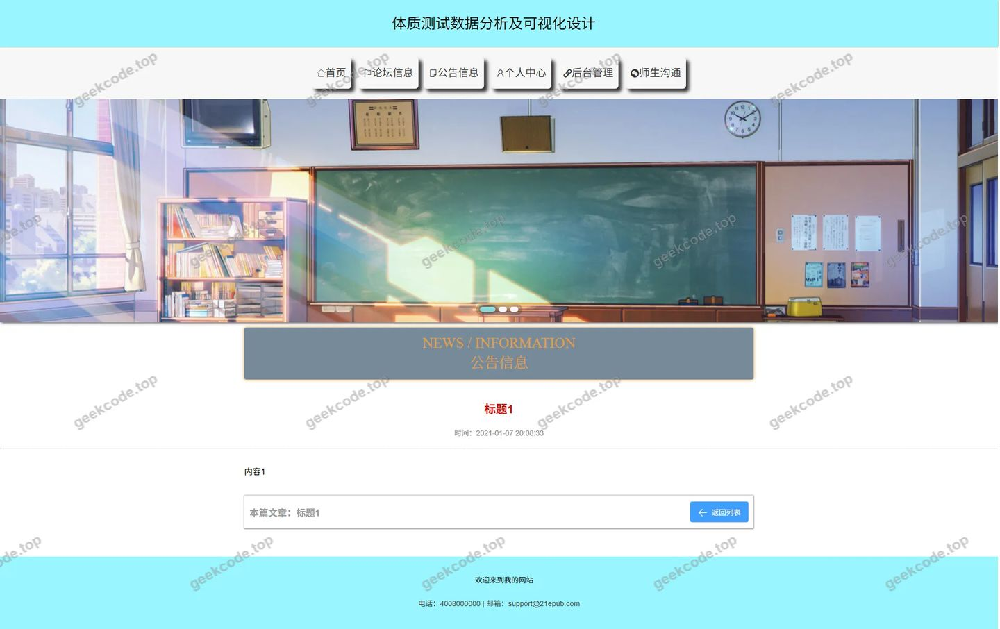</a>

<h4>前台-成绩信息列表</h4>

<h4>前台-教师列表</h4>

<a href="https://geekcode.top/archives/%E4%BD%93%E8%B4%A8%E6%B5%8B%E8%AF%95%E6%95%B0%E6%8D%AE%E5%88%86%E6%9E%90%E5%8F%8A%E5%8F%AF%E8%A7%86%E5%8C%96%E8%AE%BE%E8%AE%A1?utm_source=github" title="查看完整源码">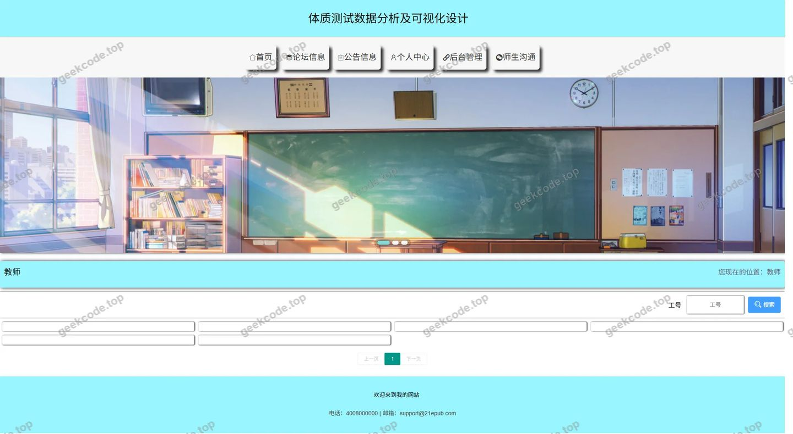</a>

<h4>前台-日常运动列表</h4>

<h4>前台-运动分析列表</h4>

<h4>前台-成绩信息-详情</h4>

<a href="https://geekcode.top/archives/%E4%BD%93%E8%B4%A8%E6%B5%8B%E8%AF%95%E6%95%B0%E6%8D%AE%E5%88%86%E6%9E%90%E5%8F%8A%E5%8F%AF%E8%A7%86%E5%8C%96%E8%AE%BE%E8%AE%A1?utm_source=github" title="查看完整源码">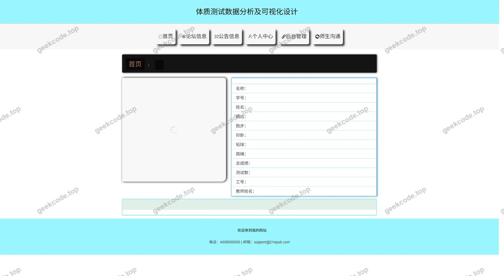</a>

<h4>前台-教师-详情</h4>

<a href="https://geekcode.top/archives/%E4%BD%93%E8%B4%A8%E6%B5%8B%E8%AF%95%E6%95%B0%E6%8D%AE%E5%88%86%E6%9E%90%E5%8F%8A%E5%8F%AF%E8%A7%86%E5%8C%96%E8%AE%BE%E8%AE%A1?utm_source=github" title="查看完整源码">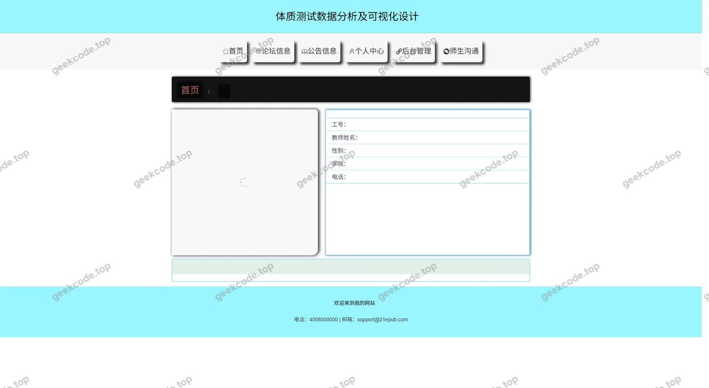</a>

<h4>前台-日常运动-详情</h4>

<a href="https://geekcode.top/archives/%E4%BD%93%E8%B4%A8%E6%B5%8B%E8%AF%95%E6%95%B0%E6%8D%AE%E5%88%86%E6%9E%90%E5%8F%8A%E5%8F%AF%E8%A7%86%E5%8C%96%E8%AE%BE%E8%AE%A1?utm_source=github" title="查看完整源码">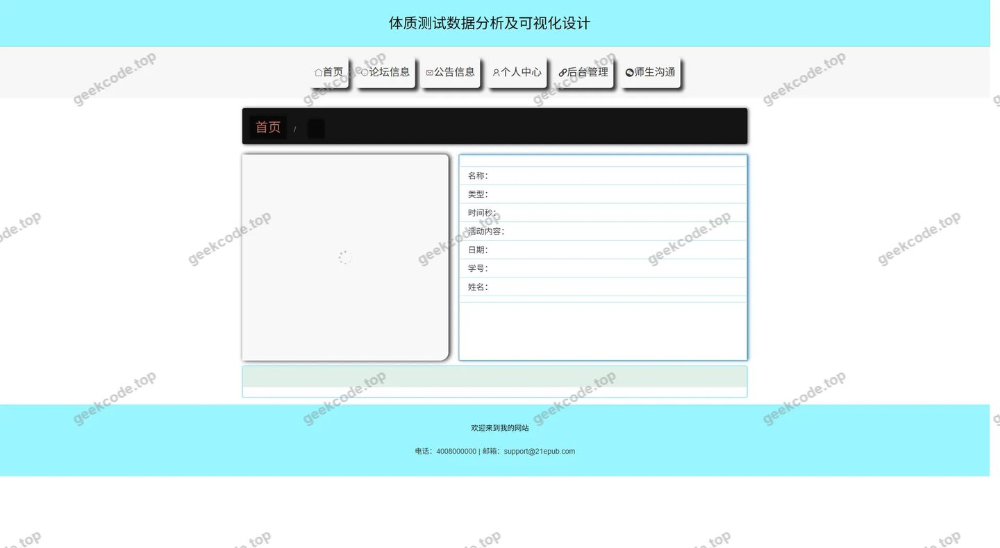</a>

<h4>前台-运动分析-详情</h4>

<a href="https://geekcode.top/archives/%E4%BD%93%E8%B4%A8%E6%B5%8B%E8%AF%95%E6%95%B0%E6%8D%AE%E5%88%86%E6%9E%90%E5%8F%8A%E5%8F%AF%E8%A7%86%E5%8C%96%E8%AE%BE%E8%AE%A1?utm_source=github" title="查看完整源码">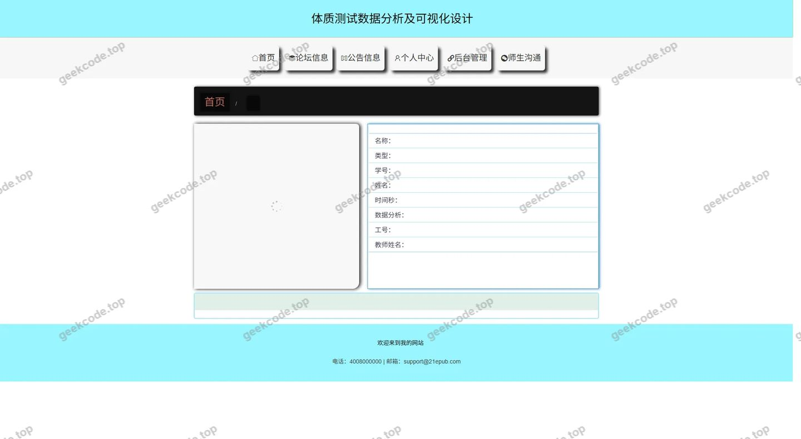</a>

<h4>前台-师生沟通聊天</h4>

<a href="https://geekcode.top/archives/%E4%BD%93%E8%B4%A8%E6%B5%8B%E8%AF%95%E6%95%B0%E6%8D%AE%E5%88%86%E6%9E%90%E5%8F%8A%E5%8F%AF%E8%A7%86%E5%8C%96%E8%AE%BE%E8%AE%A1?utm_source=github" title="查看完整源码">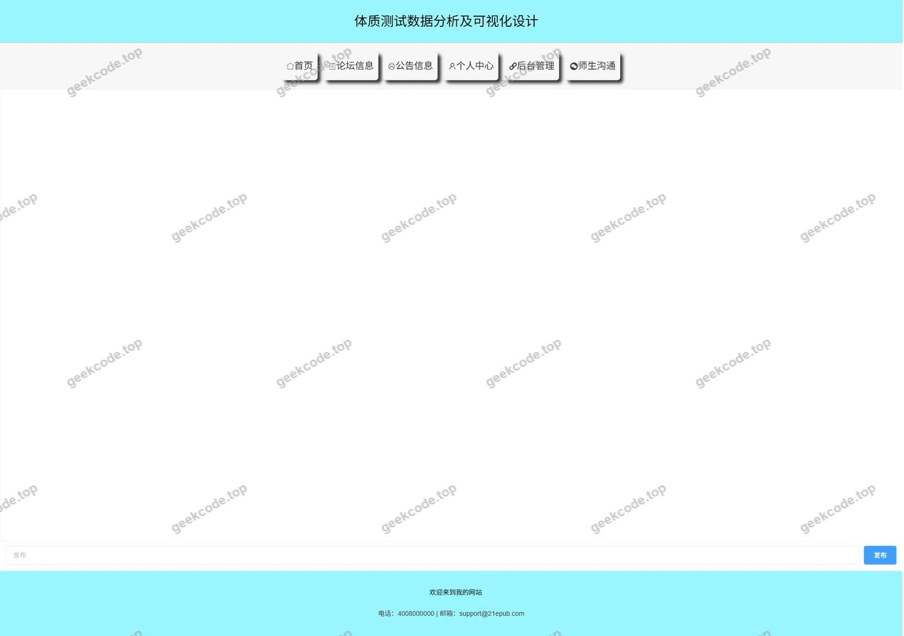</a>

<h3>后台管理端</h3>
<h4>后台-在线客服</h4>

<a href="https://geekcode.top/archives/%E4%BD%93%E8%B4%A8%E6%B5%8B%E8%AF%95%E6%95%B0%E6%8D%AE%E5%88%86%E6%9E%90%E5%8F%8A%E5%8F%AF%E8%A7%86%E5%8C%96%E8%AE%BE%E8%AE%A1?utm_source=github" title="查看完整源码">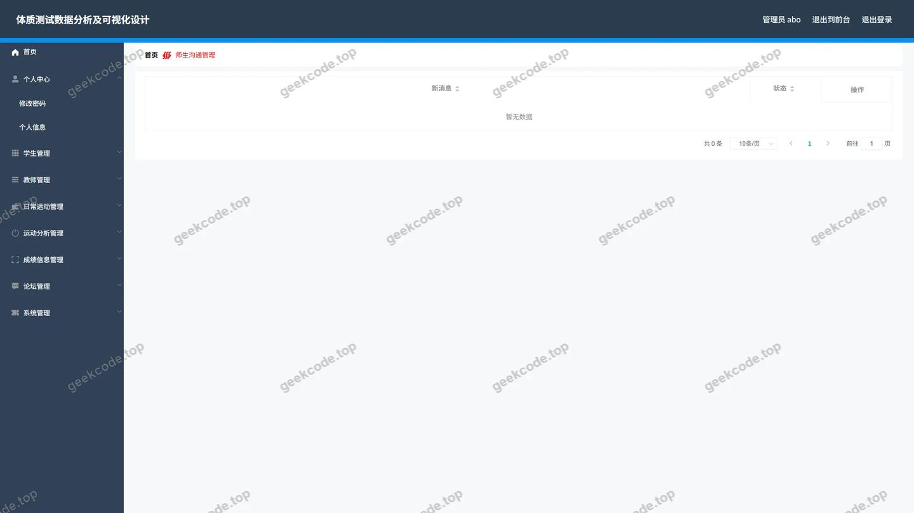</a>

<h4>后台-成绩信息</h4>

<a href="https://geekcode.top/archives/%E4%BD%93%E8%B4%A8%E6%B5%8B%E8%AF%95%E6%95%B0%E6%8D%AE%E5%88%86%E6%9E%90%E5%8F%8A%E5%8F%AF%E8%A7%86%E5%8C%96%E8%AE%BE%E8%AE%A1?utm_source=github" title="查看完整源码">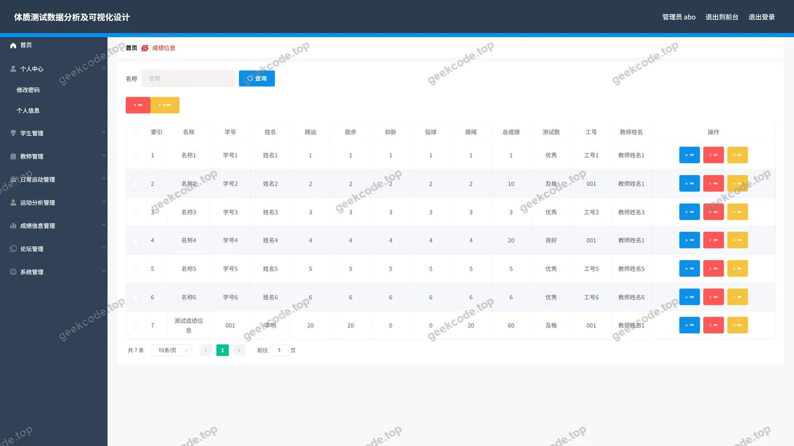</a>

<h4>后台-系统配置</h4>

<a href="https://geekcode.top/archives/%E4%BD%93%E8%B4%A8%E6%B5%8B%E8%AF%95%E6%95%B0%E6%8D%AE%E5%88%86%E6%9E%90%E5%8F%8A%E5%8F%AF%E8%A7%86%E5%8C%96%E8%AE%BE%E8%AE%A1?utm_source=github" title="查看完整源码">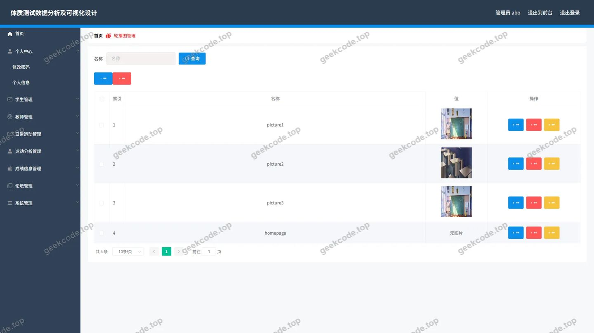</a>

<h4>后台-论坛</h4>

<a href="https://geekcode.top/archives/%E4%BD%93%E8%B4%A8%E6%B5%8B%E8%AF%95%E6%95%B0%E6%8D%AE%E5%88%86%E6%9E%90%E5%8F%8A%E5%8F%AF%E8%A7%86%E5%8C%96%E8%AE%BE%E8%AE%A1?utm_source=github" title="查看完整源码">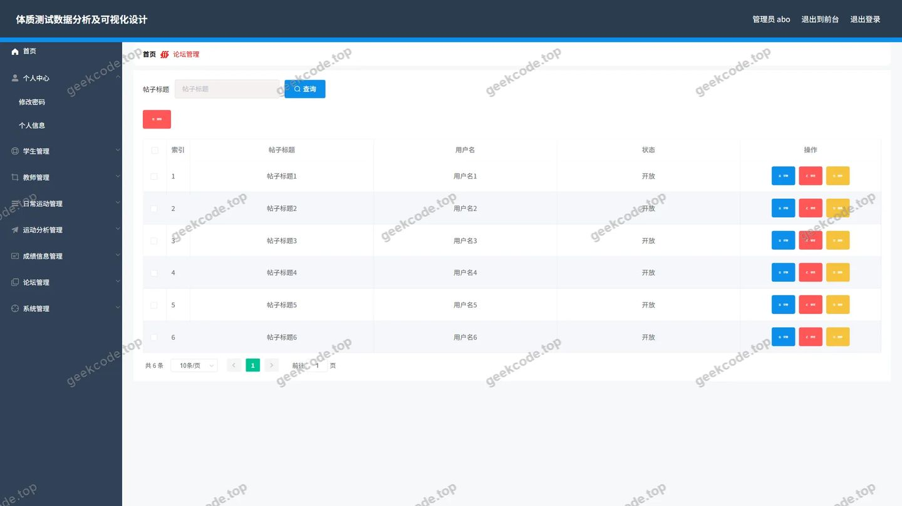</a>

<h4>后台首页</h4>

<a href="https://geekcode.top/archives/%E4%BD%93%E8%B4%A8%E6%B5%8B%E8%AF%95%E6%95%B0%E6%8D%AE%E5%88%86%E6%9E%90%E5%8F%8A%E5%8F%AF%E8%A7%86%E5%8C%96%E8%AE%BE%E8%AE%A1?utm_source=github" title="查看完整源码">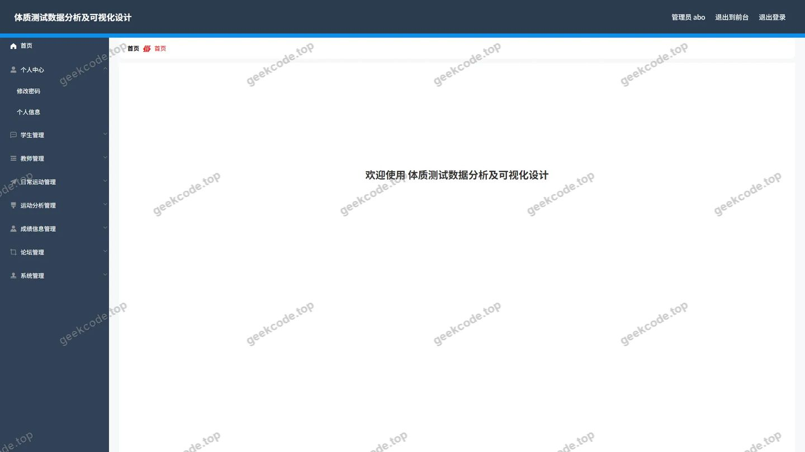</a>

<h4>后台-教师</h4>

<a href="https://geekcode.top/archives/%E4%BD%93%E8%B4%A8%E6%B5%8B%E8%AF%95%E6%95%B0%E6%8D%AE%E5%88%86%E6%9E%90%E5%8F%8A%E5%8F%AF%E8%A7%86%E5%8C%96%E8%AE%BE%E8%AE%A1?utm_source=github" title="查看完整源码">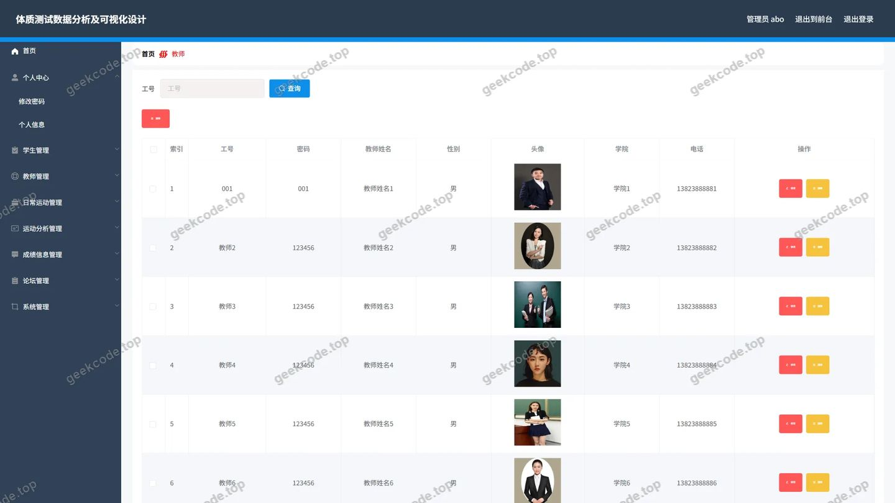</a>

<h4>后台-登录</h4>

<a href="https://geekcode.top/archives/%E4%BD%93%E8%B4%A8%E6%B5%8B%E8%AF%95%E6%95%B0%E6%8D%AE%E5%88%86%E6%9E%90%E5%8F%8A%E5%8F%AF%E8%A7%86%E5%8C%96%E8%AE%BE%E8%AE%A1?utm_source=github" title="查看完整源码">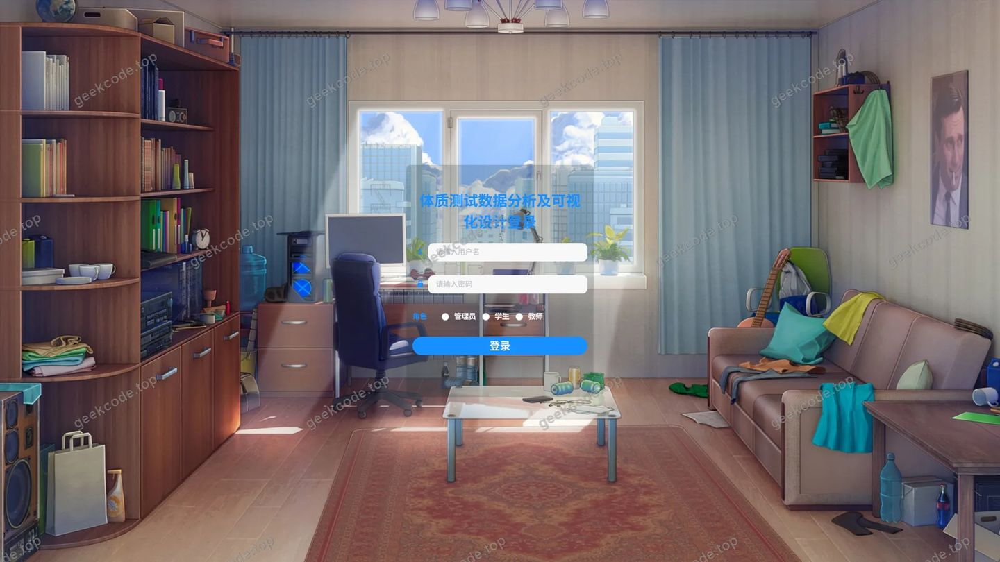</a>

<h4>后台-公告信息</h4>

<a href="https://geekcode.top/archives/%E4%BD%93%E8%B4%A8%E6%B5%8B%E8%AF%95%E6%95%B0%E6%8D%AE%E5%88%86%E6%9E%90%E5%8F%8A%E5%8F%AF%E8%A7%86%E5%8C%96%E8%AE%BE%E8%AE%A1?utm_source=github" title="查看完整源码">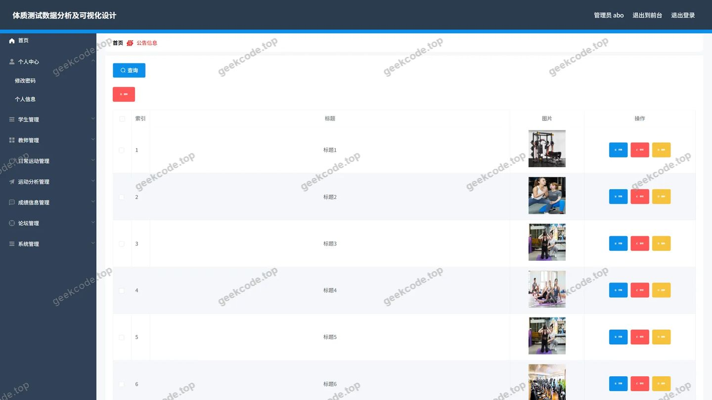</a>

<h4>后台-日常运动</h4>

<a href="https://geekcode.top/archives/%E4%BD%93%E8%B4%A8%E6%B5%8B%E8%AF%95%E6%95%B0%E6%8D%AE%E5%88%86%E6%9E%90%E5%8F%8A%E5%8F%AF%E8%A7%86%E5%8C%96%E8%AE%BE%E8%AE%A1?utm_source=github" title="查看完整源码">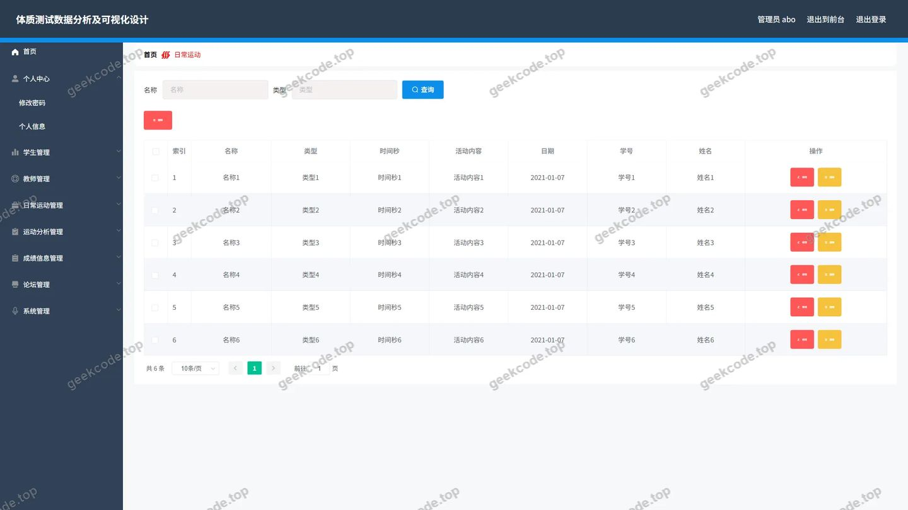</a>

<h4>后台-学生</h4>

<a href="https://geekcode.top/archives/%E4%BD%93%E8%B4%A8%E6%B5%8B%E8%AF%95%E6%95%B0%E6%8D%AE%E5%88%86%E6%9E%90%E5%8F%8A%E5%8F%AF%E8%A7%86%E5%8C%96%E8%AE%BE%E8%AE%A1?utm_source=github" title="查看完整源码">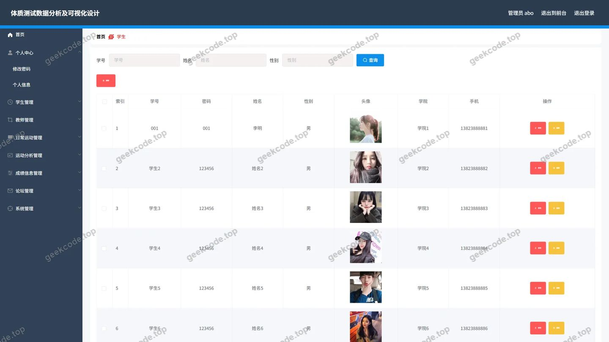</a>

<h4>后台-运动分析</h4>

<a href="https://geekcode.top/archives/%E4%BD%93%E8%B4%A8%E6%B5%8B%E8%AF%95%E6%95%B0%E6%8D%AE%E5%88%86%E6%9E%90%E5%8F%8A%E5%8F%AF%E8%A7%86%E5%8C%96%E8%AE%BE%E8%AE%A1?utm_source=github" title="查看完整源码">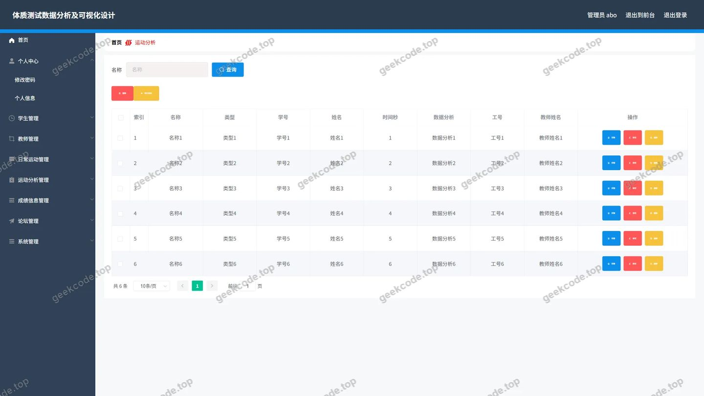</a>

---

## 获取完整源码

| 项目 | 说明 |
| --- | --- |
| 项目名 | 体质测试数据分析及可视化设计 |
| 运行截图 | 本文 28 张（站点带水印原图，仓库 `images/` 目录） |
| 完整源码 | [https://geekcode.top/archives/%E4%BD%93%E8%B4%A8%E6%B5%8B%E8%AF%95%E6%95%B0%E6%8D%AE%E5%88%86%E6%9E%90%E5%8F%8A%E5%8F%AF%E8%A7%86%E5%8C%96%E8%AE%BE%E8%AE%A1?utm_source=github](https://geekcode.top/archives/%E4%BD%93%E8%B4%A8%E6%B5%8B%E8%AF%95%E6%95%B0%E6%8D%AE%E5%88%86%E6%9E%90%E5%8F%8A%E5%8F%AF%E8%A7%86%E5%8C%96%E8%AE%BE%E8%AE%A1?utm_source=github) |
| 咨询微信 | **ir9372**（备注：jingpin-yuanma） |
| 更多项目 | [极客代码 geekcode.top](https://geekcode.top/?utm_source=github) |

> 需要源码、部署、改配置、跑不起来等问题，加微信 ir9372 沟通，说明项目名即可。
